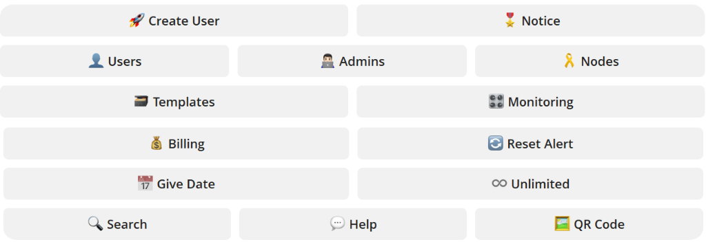

# پی‌جی اسیستنت سازگار با پاسارگارد (PG Assistant for PasarGuard)

نسخهٔ اختصاصی، پایدار و بازنویسی‌شدهٔ **پی‌جی اسیستنت (PG Assistant)** برای هماهنگی و سازگاری کامل با REST API پنل **پاسارگارد (PasarGuard v5.4.1)**.

<p align="center">
  <a href="./README.md">فارسی (صفحه اصلی)</a> |
  <a href="./README_fa.md">مستندات تفصیلی فارسی</a> |
  <a href="./README_ru.md">Русский</a> |
  <a href="./CHANGELOG_fa.md">گزارش تغییرات</a> |
  <a href="./PASARGUARD_MIGRATION.md">راهنمای مهاجرت</a>
</p>

---

<p align="center">
  
</p>

## 📱 منوی دکمه‌ها و کلیدهای پی‌جی اسیستنت (PG Assistant) در تلگرام

<p align="center">
  
</p>

---

# 📖 پی‌جی اسیستنت (PG Assistant) چیست؟

**پی‌جی اسیستنت (PG Assistant)** یک دستیار هوشمند، سریع و همه‌فن‌حریف تلگرامی برای مدیریت سرورها و کاربران پنل پروکسی است. این ربات مستقیماً از طریق لایهٔ امن **REST API پاسارگارد** کار می‌کند؛ بنابراین هیچ نیازی به لاگین مداوم به داشبورد تحت وب نبوده و تمام کارهای ادمین‌ها با سرعت بسیار بالا از طریق تلگرام قابل انجام است.

---

# 🌟 امکانات و قابلیت‌های اصلی پی‌جی اسیستنت (PG Assistant)

### ۱. 🚀 ایجاد کاربر (Create User)
- **ساخت کاربر بر اساس Groupهای پاسارگارد:** تخصیص مستقیم کاربر به `group1` (فعال) طبق استاندارد پاسارگارد به جای Inboundهای مستقیم.
- **ساخت تکی و دسته‌جمعی (Bulk Create):** تولید صدها کاربر هم‌زمان همراه با شماره‌گذاری خودکار و دریافت فوری لینک سابسکریپشن.
- **شروع زمان پس از اولین اتصال (On-Hold):** محاسبهٔ مدت زمان اکانت دقیقاً از لحظهٔ اولین اتصال کاربر.

### ۲. 🎖️ پیام و اعلان اتمام بسته (Notice)
- پایش خودکار کاربران و ارسال پیام اعلان در صورت اتمام ترافیک یا پایان زمان اشتراک.

### ۳. 👤 مدیریت و آمار کاربران (Users)
- مشاهدهٔ وضعیت آماری دقیق پنل: فعال، منقضی، در انتظار و محدودشده.
- استخراج فهرست کاربران بر اساس بازهٔ زمانی آنلاین/آفلاین به صورت جدول و فایل **PDF**.

### ۴. 👨🏻‍💻 مدیریت مدیران و نقش‌ها (Admins)
- کاملاً منطبق بر معماری دسترسی **Roleها (RBAC)** در پاسارگارد (`role_id`).
- افزودن ادمین جدید، تغییر رمز عبور، ویرایش سطح دسترسی و حذف ایمن ادمین‌ها.

### ۵. 🎗️ مدیریت و مانیتورینگ نودها (Nodes & Monitoring)
- بررسی پیوستهٔ وضعیت اتصال نودهای Xray و WireGuard.
- ارسال پیام هشدار فوری در تلگرام در صورت بروز اختلال یا قطعی در نودها.

### ۶. 🗃️ تمپلیت‌ها و الگوهای آماده (Templates)
- تعریف و ذخیرهٔ بسته‌های پیش‌فرض (مثلاً «۵۰ گیگابایت / ۳۰ روزه / گروه ۱») برای ساخت کاربر در کسری از ثانیه.

### ۷. 💰 سیستم مالی و حسابداری (Billing)
- محاسبهٔ دقیق ترافیک مصرفی و باقی‌ماندهٔ کاربران به تفکیک هر ادمین/همکار.
- صفحه‌بندی کامل کاربران و بدون افت سرعت حتی در پنل‌های با بیش از ۱۰,۰۰۰ کاربر.

### ۸. 🔄 اعلان ریست ترافیک (Reset Alert)
- ثبت و ارسال اعلان به ادمین به هنگام ریست شدن دوره‌ای یا دستی مصرف کاربران.

### ۹. 📅 ثبت تاریخ (Give Date)
- مدیریت و اختصاص تاریخ انقضا برای کاربرانی که بدون تاریخ انقضا ساخته شده‌اند.

### ۱۰. ♾️ کاربران نامحدود (Unlimited)
- شناسایی هوشمند کاربران دارای حجم نامحدود و تفکیک آن‌ها در گزارش‌های مالی تا مانع خطای محاسباتی سهمیه ادمین‌ها نشود.

### ۱۱. 🔍 جستجوی هوشمند (Search)
- پیدا کردن اکانت کاربر تنها با ارسال چند حرف اولیه (قابلیت فازی Did you Mean).

### ۱۲. 🖼️ بارکد اختصاصی (QR Code)
- تولید و ارسال تصویر QR Code برای لینک سابسکریپشن کاربران یا هر لینک دیگر با امکان تنظیم رنگ.

### ۱۳. 💬 راهنما و پشتیبانی (Help)
- راهنمای کار با دستورات به همراه ارسال مستقیم لاگ‌های زندهٔ سرویس‌های `systemd` به ادمین برای خطایابی سریع.

---

# 🚀 راهنمای نصب سریع روی سرور

برای نصب پی‌جی اسیستنت (PG Assistant) روی سرورهای **Ubuntu 22.04 یا 24.04** از دستور زیر استفاده کنید:

```bash
sudo bash -c "$(curl -sL https://github.com/sirvan1133/pgassistant/raw/main/holderbot.sh)"
```

### دستورات کنترلی:

- **راه‌اندازی مجدد سرویس‌ها:**
```bash
sudo bash -c "$(curl -sL https://github.com/sirvan1133/pgassistant/raw/main/restart.sh)"
```

- **حذف کامل ربات:**
```bash
sudo bash -c "$(curl -sL https://github.com/sirvan1133/pgassistant/raw/main/uninstall.sh)"
```

---

# ⚙️ معماری سرویس‌های پس‌زمینه (Systemd)

پی‌جی اسیستنت (PG Assistant) برای پایداری ۱۰۰٪ به ۵ سرویس مستقل `systemd` تقسیم شده است که پس از ریبوت سرور خودکار اجرا می‌شوند:
1. `holderbot@holder.service` — پردازشگر اصلی ربات تلگرام
2. `holderbot@monitoring.service` — پایش زنده وضعیت نودها
3. `holderbot@limiteder.service` — انتقال خودکار کاربران حجم‌تمام‌شده به `group2`
4. `holderbot@expired.service` — انتقال کاربران منقضی‌شده به `group2`
5. `holderbot@reseter.service` — سیستم مدیریت بازنشانی دوره‌ای ترافیک

---
